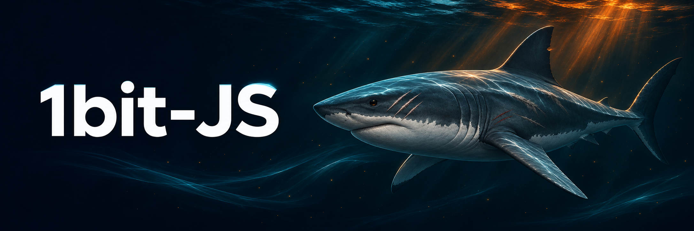

I'm a **full-stack developer connecting industrial devices with web and mobile services**.

Since 2020, I've worked across web, backend, and mobile development, mainly with TypeScript.
My work spans industrial IoT monitoring, device integration, and tools for installation,
inspection, and field service.

## What I work on

- **Web & Backend** — Operational dashboards and business workflows with React and NestJS
- **Mobile** — Field service apps with React Native and Expo
- **Device Integration** — Data collection, device monitoring, and backend integration

I care about how data moves through a system, how it handles unexpected conditions,
and whether people can get their work done with it.

## Main stack

TypeScript · React · Node.js · NestJS · React Native · Expo · PostgreSQL

## Recently

- Working on DAQ sensor data collection and backend integration with Python
- Building **Shellfin**, a desktop SSH client with React, Tauri, and Rust

---

한국어 소개

### 안녕하세요, 1bit-JS입니다 👋

현장 장비와 운영 서비스를 연결하는 **6년차 풀스택 개발자**입니다.

TypeScript를 중심으로 웹, 백엔드, 모바일 앱을 개발해왔습니다.
산업 IoT 환경에서 장비 데이터가 서버와 화면으로 이어지는 흐름,
그리고 설치·점검·출동 같은 실제 업무를 서비스로 구현하는 일을 해왔습니다.

### 주로 하는 일

- **웹·백엔드** — React와 NestJS 기반 운영 대시보드와 업무 기능
- **모바일** — React Native와 Expo를 활용한 현장 업무 앱
- **장비 연동** — 데이터 수집, 장비 상태 모니터링, 백엔드 연동

데이터가 시스템을 따라 흐르는 방식, 예상치 못한 상황을 처리하는 방법,
사용자가 실제로 업무를 마칠 수 있는 경험을 중요하게 생각합니다.

### 주력 기술

TypeScript · React · Node.js · NestJS · React Native · Expo · PostgreSQL

### 최근 작업

- Python으로 DAQ 센서 데이터 수집과 백엔드 연동 작업
- React, Tauri, Rust로 SSH 데스크톱 도구 **Shellfin** 개발

